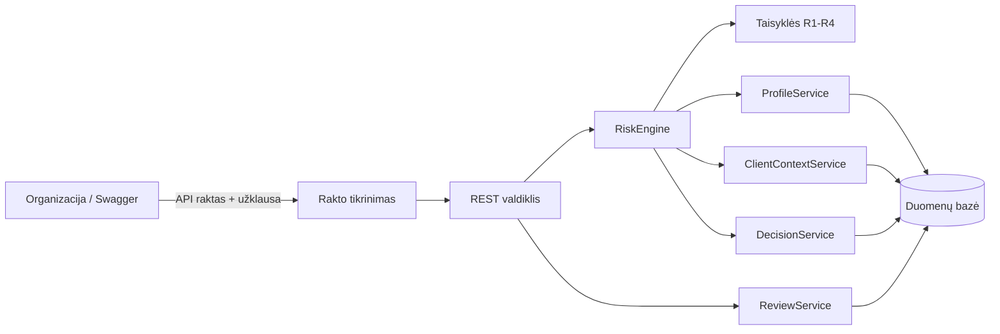

# Mokėjimų rizikos vertinimo sistema

Kursinio darbo I dalis: projektavimo dokumentas

## 1. Problema ir idėja

**Sistema vienu sakiniu:** Sistema skirta organizacijoms, kurios priima mokėjimus (pvz., internetinėms parduotuvėms): ji kiekvienam mokėjimui apskaičiuoja rizikos balą ir nusprendžia, ar mokėjimą patvirtinti (APPROVE), perduoti žmogui peržiūrėti (REVIEW), ar blokuoti (BLOCK).

**Problema ir dabartinis procesas:** Darome prielaidą, kad nedidelė organizacija įtartinus mokėjimus dabar tikrina rankiniu būdu arba naudoja kelias taisykles, įrašytas tiesiai į programos kodą. Tokio būdo trūkumai gali būti šie:
1. Norint pridėti naują taisyklę, reikia keisti seną kodą, todėl galima sugadinti tai, kas jau veikia.
2. Nematyti, kodėl mokėjimas sustabdytas: kuri taisyklė suveikė ir kiek ji prisidėjo.
3. Visos organizacijos turi tą pačią griežtumo ribą, nors vienos nori griežtesnės apsaugos, kitos – mažiau trukdyti pirkėjams.

**Nauda:** Mokėjimai vertinami greitai ir vienodai. Prie kiekvieno sprendimo matyti, kurios taisyklės suveikė. Kiekviena organizacija gali pasirinkti savo griežtumą. Naują taisyklę galima pridėti nekeičiant senų.

**Naudotojai:** Organizacija per API siunčia mokėjimus vertinimui, keičia savo rizikos profilį ir tvarko savo peržiūros eilę.

**Prielaidos:**
- Taisyklių ribos (pvz., 1 000 €, 10 min.) ir pradiniai balai yra mano pasirinktos pradinės reikšmės, o ne realūs duomenys.
- Šalį ir gavėjo ID mums atsiunčia kita sistema, jų netikriname.
- Palaikomos valiutos EUR, USD, GBP. Sumos paverčiamos eurais pagal fiksuotą kursų lentelę.
- Kiekviena organizacija jau turi API raktą (jį išduoda sistemos administratorius, valdymo ekrano nekursime).

## 2. Apimtis

| Funkcija | Ką naudotojas galės atlikti | Pagrindinis modulis ar pagalbinė funkcija |
|---|---|---|
| Mokėjimo vertinimas | Nusiųsti mokėjimą ir gauti sprendimą, balą ir suveikusių taisyklių sąrašą | **Pagrindinis modulis** |
| Organizacijos profilis | Pakeisti taisyklių balus, įjungti ar išjungti taisykles, nustatyti slenksčius. Jei profilio nėra, taikomas numatytasis | Pagalbinė |
| Prieiga pagal API raktą | Organizacija mato ir keičia tik savo duomenis | Pagalbinė |
| Peržiūros eilė | Patvirtinti ar atmesti REVIEW mokėjimą ir parašyti komentarą | Pagalbinė |
| Istorijos saugojimas | Išsaugoti įvertintus mokėjimus, kad vėliau būtų galima skaičiuoti kliento vidurkį ir žinomus gavėjus | Pagalbinė |

**Į kursinio darbo apimtį neįeina:** naudotojų paskyros, slaptažodžiai ir vaidmenys (naudojami tik API raktai); grafinė sąsaja (demonstruosime per Swagger); ryšys su tikrais bankais; mašininis mokymasis; tikri valiutų kursai; taisyklių ribų (pvz., 1 000 €) keitimas profilyje; organizacijų pačių kuriamos taisyklės.

## 3. Pagrindinis modulis

**Pavadinimas ir paskirtis:** *Rizikos vertinimo modulis (RiskEngine).* Gauna mokėjimą, kliento istoriją ir organizacijos profilį, pritaiko taisykles, sudeda balus ir parenka sprendimą.

**Įvestis:** mokėjimas JSON formatu ir API raktas užklausos antraštėje, pvz.:
`{ "clientId": "C2", "amount": 1000.00, "currency": "EUR", "recipientId": "R-77", "country": "LT", "timestamp": "2026-11-10T03:00:00" }`
Be to, modulis iš duomenų bazės pasiima kliento paskutinių 30 dienų mokėjimų vidurkį, gavėjus per 90 dienų ir šalis per paskutines 10 minučių.

**Išvestis:** `{ "decision": "REVIEW", "score": 40, "triggeredRules": [ {"rule": "R2_NEW_RECIPIENT", "points": 25}, {"rule": "R4_NIGHT_LARGE", "points": 15} ] }`

**Veikimo eiga:**
1. Pagal API raktą randama organizacija ir patikrinami mokėjimo duomenys.
2. Suma paverčiama eurais, paimamas organizacijos profilis (arba numatytasis) ir kliento istorija.
3. Kiekviena įjungta taisyklė grąžina balus (0, jei nesuveikė).
4. Balai sudedami (daugiausia 100) ir pagal profilio slenksčius parenkamas sprendimas.
5. Rezultatas išsaugomas. Jei sprendimas REVIEW, mokėjimas patenka į organizacijos peržiūros eilę.

### Taisyklės

Numatyti balai ir slenksčiai (organizacija gali keisti balus, įjungimą ir slenksčius):

1. **R1_AMOUNT_SPIKE (+30):** suma yra daugiau nei 5 kartus didesnė už kliento 30 dienų vidurkį. Taikoma tik jei klientas per tą laiką turi bent 5 mokėjimus.
2. **R2_NEW_RECIPIENT (+25):** klientas per paskutines 90 dienų nėra mokėjęs šiam gavėjui ir suma ≥ 1 000 €.
3. **R3_MULTI_COUNTRY (+40):** per 10 minučių (kartu su dabartiniu) mokėjimai atlikti iš bent 3 skirtingų šalių.
4. **R4_NIGHT_LARGE (+15):** mokėjimas atliktas nuo 00:00 iki 05:00 (05:00 jau nebe naktis) ir suma ≥ 500 €.
5. **Sprendimas pagal balą:** 0–39 APPROVE, 40–69 REVIEW, nuo 70 BLOCK. Jei balas lygus slenksčiui, taikomas aukštesnis sprendimas.
6. **Profilio tikrinimas:** REVIEW slenkstis turi būti mažesnis už BLOCK slenkstį, o balai – nuo 0 iki 100.

### Scenarijai būsimiems testams

| Scenarijus | Pradinės sąlygos ir įvestis | Veiksmas | Tikslus laukiamas rezultatas |
|---|---|---|---|
| Įprastas atvejis | Organizacija A (numatytasis profilis). Klientas C1: 10 mokėjimų, vidurkis 40 €, gavėjas R-12 jau matytas. Mokėjimas 20 €, LT, 14:30 | Nusiųsti mokėjimą | Nė viena taisyklė nesuveikia. Balas 0, **APPROVE** |
| Ribinis atvejis | Organizacija A. Klientas C2: 8 mokėjimai, vidurkis 300 € (R1 riba 1 500 €). Gavėjas R-77 naujas. Mokėjimas 1 000 €, LT, 03:00 | Nusiųsti mokėjimą | Suveikia R2 (+25) ir R4 (+15). Balas lygiai 40, **REVIEW**, mokėjimas patenka į eilę |
| Skirtingi profiliai | Tas pats mokėjimas kaip ankstesniame, bet organizacijos B profilyje REVIEW slenkstis 25, BLOCK slenkstis 40 | Nusiųsti mokėjimą | Balas 40, **BLOCK**. Organizacijai A sprendimas lieka REVIEW |
| Klaida: blogi duomenys | Valiuta „XXX“ arba suma −50 | Nusiųsti mokėjimą | **400 INVALID_PAYMENT** su priežastimi, balas neskaičiuojamas |
| Klaida: neleistina prieiga | Organizacija A bando pakeisti organizacijos B profilį, arba užklausa su neteisingu raktu | Nusiųsti užklausą | **403** (svetimas profilis) arba **401** (neteisingas raktas), niekas nekeičiama |

Taisykles R1 ir R3 papildomai patikrins vienetų testai (pvz., 4 800 € mokėjimas, kai vidurkis 100 €, duoda +30 pagal R1).

**Jei modulis naudoja AI:** Netaikoma. Modulis visada to paties mokėjimo atveju duoda tą patį rezultatą.

## 4. Kokybės atributas

**Pasirinktas atributas:** palaikomumas, tiksliau – kad naują taisyklę būtų lengva pridėti nekeičiant esamų.

**Kodėl svarbus šiai sistemai:** Sukčiavimo būdai keičiasi, todėl naujų taisyklių prireiks dažnai. Jei kiekviena nauja taisyklė keistų senąjį kodą, galėtume sugadinti taisykles, kurios jau veikia visoms organizacijoms.

**Tikrinimo scenarijus:** Prototipo pabaigoje pridėsiu naują taisyklę **R5_HIGH_RISK_COUNTRY** (+20 balų, jei mokėjimas atliktas iš šalies, esančios sąraše). Prieš tai visi scenarijų testai turi praeiti.

**Sėkmės kriterijus (ką skaičiuosiu):**
- sukuriama 1 nauja klasė ir pakeičiama ne daugiau kaip 5 konfigūracijos eilutės;
- 0 pakeistų eilučių senose taisyklių klasėse ir `RiskEngine` (patikrinsiu per `git diff`);
- visi ankstesni testai praeina be pakeitimų;
- bent 2 nauji R5 testai praeina.

**Projektavimo sprendimas:** Kiekviena taisyklė yra atskira klasė su ta pačia sąsaja `RiskRule`. `RiskEngine` gauna visų taisyklių sąrašą ir nežino, kokios tai taisyklės. Todėl nauja taisyklė pridedama kaip dar viena klasė. Balai ir slenksčiai laikomi konfigūracijoje ir profiliuose, ne kode.

**Kaip patikrinsiu:** Pridėsiu R5, su `git diff` suskaičiuosiu pakeistas eilutes senose klasėse, paleisiu visus testus ir rezultatą užrašysiu ataskaitoje.

**Kaina ir ribojimas:** Pradžioje reikia daugiau darbo (sąsaja ir atskiros klasės vietoj vieno ilgo `if` bloko). Taisyklės turi būti nepriklausomos viena nuo kitos, nes jų vykdymo tvarka nenustatyta.

## 5. Pradinė sistemos struktūra

| Sistemos dalis | Atsakomybė |
|---|---|
| Rakto tikrinimas | Pagal API raktą randa organizaciją. Neteisingas raktas – 401, svetimi duomenys – 403 |
| REST valdiklis | Priima užklausas, tikrina mokėjimo duomenis, grąžina atsakymus ir klaidų kodus |
| RiskEngine | Pagrindinė logika: paleidžia taisykles ir sudeda balus |
| Taisyklės R1-R4 | Kiekviena yra atskira klasė su sąsaja `RiskRule` |
| ProfileService | Grąžina organizacijos profilį (arba numatytąjį) ir patikrina, ar jis tinkamas |
| ClientContextService | Iš istorijos paskaičiuoja kliento vidurkį, matytus gavėjus ir šalis per 10 min. |
| DecisionService | Pagal slenksčius parenka sprendimą ir jį išsaugo |
| ReviewService | Tvarko organizacijos peržiūros eilę |
| Duomenų bazė | Saugo mokėjimus, sprendimus, profilius, peržiūros eilę ir API raktus (kaip maišos, ne atvirą tekstą) |

**Technologijos ir kodėl jas pasirinkau:**
- **Java 21 (LTS):** šią kalbą naudojame kurse. Pinigų sumoms naudosiu `BigDecimal`, nes `double` gali duoti smulkių apvalinimo klaidų.
- **Spring Boot:** greitai leidžia padaryti REST API, tikrinti įvestį ir automatiškai surinkti visas taisykles į sąrašą.
- **PostgreSQL ir Spring Data JPA:** patikimas duomenų saugojimas ir paieška pagal laiką. Testams naudosiu H2 (bazė atmintyje).
- **Maven, JUnit 5, Mockito, Swagger:** projekto surinkimas, testai ir demonstravimas be grafinės sąsajos.
- **Git ir GitHub:** kodui saugoti, kaip reikalauja užduotis.

## 6. AI panaudojimas

### AI rengiant šį dokumentą

| Priemonė ir užduotis | Ką panaudojau | Ką atmečiau arba perrašiau ir kodėl | Kaip patikrinau |
|---|---|---|---|
| Claude: idėja ir dokumento juodraštis pagal šabloną | Idėją (mokėjimų rizikos vertinimas), taisyklių ir scenarijų struktūrą, technologijų sąrašą | Atmečiau AI funkciją pačioje sistemoje, nes sprendimai turi būti tikslūs ir testuojami. Dokumentą sutrumpinau, pašalinau antrą kokybės atributą | Palyginau su užduoties aprašu ir rankiniu būdu perskaičiavau scenarijų balus |
| Claude: problemos aprašas | Bendrą kryptį | Perrašiau teiginį, kad organizacijos „dažnai“ taip daro, nes jis neturėjo šaltinio. Pakeičiau į prielaidą | Paklausiau, iš kur teiginys, ir perrašiau |
| Claude: organizacijų profiliai ir API raktas | Savo idėją, kad kiekviena organizacija galėtų keisti savo profilį; Claude pasiūlė prieigos variantus | Atmečiau pilną „Spring Security“ su JWT ir vaidmenimis kaip per didelį šiai užduočiai; pasirinkau API raktą | Palyginau variantus pagal darbo kiekį ir užduoties aprašą |

### Planuojamas AI naudojimas kuriant sistemą

**Kur naudosiu AI:** Kodo pradžiai (valdikliai, esybės), papildomų ribinių atvejų idėjoms, klaidų paaiškinimui ir kodo peržiūrai.

**Kaip tikrinsiu:** Nekopijuosiu to, ko nesuprantu. Sugeneruotas taisykles lyginsiu su šio dokumento scenarijais (balai turi sutapti), paleisiu testus, o sugeneruotus testus perskaitysiu, kad netikrintų per mažai. Rizika: AI gali parašyti kitokią ribinę sąlygą (≥ vietoj >), todėl ribinius atvejus tikrinsiu atskirai.

**Ar AI bus pačioje sistemoje:** Ne. Sprendimus priima taisyklės, todėl tas pats mokėjimas su ta pačia istorija visada duoda tą patį rezultatą, o kiekvieną sprendimą galima paaiškinti konkrečia taisykle.

## 7. Tolesnių darbų planas

| Darbas | Rezultatas | Eilės tvarka |
|---|---|---|
| Projekto pradžia ir duomenų modelis | Spring Boot projektas GitHub repozitorijoje, esybės `Payment`, `Decision`, `RiskProfile`, `ReviewItem` | 1 |
| Taisyklės R1-R4 ir RiskEngine | Sąsaja `RiskRule`, 4 taisyklės, balų sudėjimas, slenksčiai; praeina 1, 2 ir 4 scenarijai | 2 |
| Profiliai ir API raktas | `ProfileService` su tikrinimu ir rakto tikrinimas; praeina 3 ir 5 scenarijai | 3 |
| REST API ir peržiūros eilė | `POST /payments`, `PUT /profile`, `GET/POST /reviews`, Swagger | 4 |
| Kokybės atributo patikra | R5 pridėjimo eksperimentas su `git diff` ir testų rezultatais | 5 |

**Prototipo demonstracija:** Per Swagger su organizacijos A raktu nusiųsiu mokėjimą (C2, 1 000 €, naujas gavėjas, 03:00) ir tikiuosi **REVIEW**, balo 40, taisyklių R2 (+25) ir R4 (+15). Tada su organizacijos B raktu (BLOCK slenkstis 40) nusiųsiu tą patį mokėjimą ir tikiuosi **BLOCK**. Galiausiai su A raktu bandysiu pakeisti B profilį ir tikiuosi 403.

| Rizika | Kaip sumažinsiu |
|---|---|
| Darbo per daug dėl profilių ir prieigos | Ribosiu: tik balai, įjungimas ir slenksčiai, jokių valdymo ekranų. Pirmiausia padarysiu modulį su numatytuoju profiliu |
| Klaidos su laiku (R3 10 min. langas, R4 naktis) | Skaičiuosiu pagal mokėjimo `timestamp`, rašysiu atskirus testus ties 04:59 / 05:00 ir lango riba |
| Balai ir slenksčiai išgalvoti (nėra tikrų duomenų) | Laikau juos profiliuose, užrašau kaip prielaidą ir parodau, kad juos galima keisti nekeičiant kodo |

## Šaltiniai, jei naudojote

Išoriniais šaltiniais neremta. Taisyklės ir reikšmės yra mano pasirinkti pavyzdžiai. AI naudojimas aprašytas 6 skyriuje.
